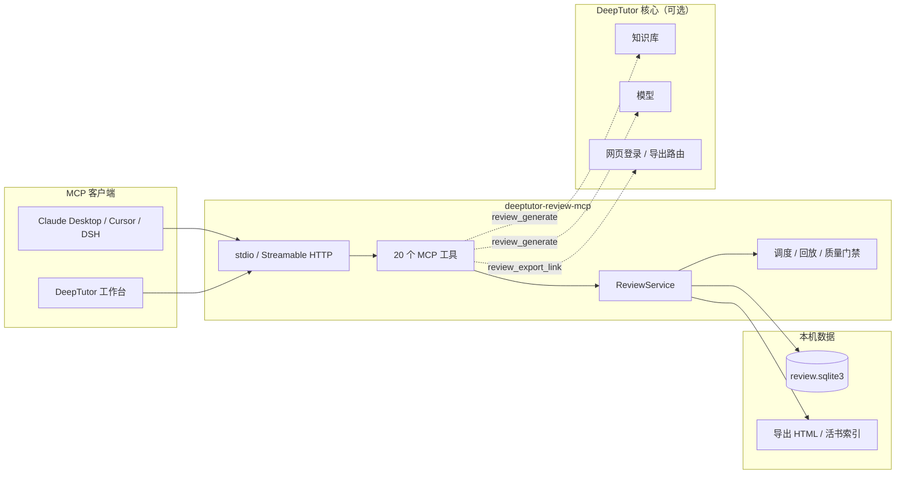
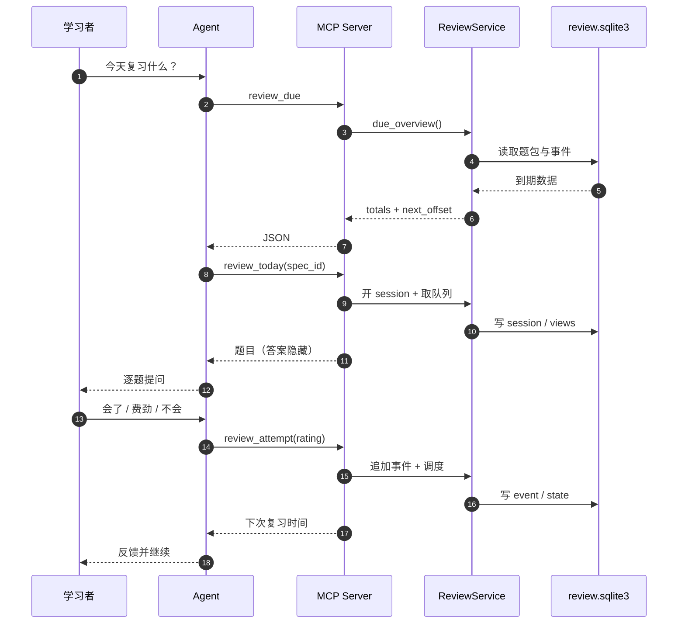

# deeptutor-review-mcp

> 把课程材料变成**可自评、可调度、可导出**的间隔复习包。
> 一个独立的 MCP 服务器：Agent 负责出题和记录，评分始终由学习者自己给出。

[](https://github.com/zkw90274-dot/deeptutor-review-mcp/actions/workflows/ci.yml)
[](https://github.com/zkw90274-dot/deeptutor-review-mcp/releases)
[](https://www.python.org/)
[](LICENSE)
[](https://modelcontextprotocol.io/)

**20 个工具 · stdio / Streamable HTTP · 无云端账号 · 单租户 · 答案默认隐藏**

---

## 它是什么

`deeptutor-review-mcp` 把「复习工坊」从 DeepTutor 中独立出来，做成一个可以被
Claude Desktop、Cursor、DSH、DeepTutor 工作台等 MCP 客户端直接调用的复习服务器。

它围绕一个很窄的闭环工作：

```text
+--------------------+      +--------------------+      +--------------------+
| 课程知识库章节     | ---> | review_generate    | ---> | 质量门禁           |
+--------------------+      +--------------------+      +--------------------+
                                                                   |
                                                                   v
+--------------------+      +--------------------+      +--------------------+
| 弱项 / 导出        | <--- | 自评 + SRS 调度    | <--- | review_today       |
| weakness / export  |      | again/hard/good    |      | 答案隐藏的今日队列 |
+--------------------+      +--------------------+      +--------------------+
```

设计上只做四件事：

- **出题**：从知识库章节生成题包，入库前过质量门禁。
- **复习**：按间隔重复调度给出今日队列，答案和解析不提前下发。
- **记录**：只记录学习者自己的三档自评：`again` / `hard` / `good`。
- **看结果**：给出弱项、下次复习预测，以及可打印/可离线打开的导出页。

它**不是**自动判分器，也**不是**多租户 SaaS。所有状态都在本机的一个目录里。

## 架构

实线是本地调用；虚线是可选依赖。没有 DeepTutor 网页端时，除
`review_export_link` 外都能工作。`review_generate` 和 `review_plan` 的
`create` 需要本地知识库；其中 `review_generate` 还需要模型。



## 5 分钟上手

### 1. 安装

需要 **Python 3.11+**。推荐从 release tag 安装：

```bash
git clone https://github.com/zkw90274-dot/deeptutor-review-mcp.git
cd deeptutor-review-mcp
git checkout main
python -m venv .venv

# Windows PowerShell
.venv\Scripts\Activate.ps1
# Windows Git Bash
source .venv/Scripts/activate
# macOS / Linux
# source .venv/bin/activate

pip install .
```

也可以直接从 git 安装：

```bash
pip install "git+https://github.com/zkw90274-dot/deeptutor-review-mcp.git@main"
```

如果已经有 DeepTutor 1.7.3 环境，从当前 `main` 构建并安装 wheel：

```bash
python -m pip wheel . --no-deps -w dist
python -m pip install --force-reinstall --no-deps dist/deeptutor_review-1.7.3-3-py3-none-any.whl
deeptutor-review-mcp --check
```

| 版本项 | 值 |
|---|---|
| 包版本 | `1.7.3` |
| wheel build | `3` |
| 当前 `main` | 20 工具、schema v9（R4–R6） |
| 最近 release | `v1.7.3-r3`（旧工具面） |
| 兼容核心 | DeepTutor `1.7.3` |
| Python | `3.11+` |

> README 和安装命令以当前 `main` 为准；`v1.7.3-r3` 是上一个公开发布，工具面较旧。
> 运行安装请使用普通 `pip install .`，不要用 `pip install -e .`。
> wheel 还会把模块清单写进共享的 `deeptutor` namespace；editable install
> 不会合并这个数据文件。改完源码后重新执行 `pip install .` 即可。

### 2. 自检

```bash
deeptutor-review-mcp --check
```

正常输出应包含：

```text
core deeptutor    : 1.7.3
deeptutor-review  : 1.7.3
module gate       : ok
mcp tools         : 20
ready: versions match and the review module is enabled
```

### 3. 不接模型，先跑一个演示

```bash
python examples/demo/seed.py     # 生成 demo-review-home/，里面有一个 3 题演示包
python examples/demo/smoke.py    # 启动真实 stdio 服务，调用 3 个工具
```

`smoke.py` 会检查工具列表、列出题包、汇总到期量并取今日队列。退出码为 `0`
表示整条 MCP 链路已打通；这一步不需要模型，也不需要知识库。

### 4. 连接 Agent

**stdio**（Claude Desktop、Cursor、DSH、Claude Code 等）：

```json
{
  "mcpServers": {
    "deeptutor-review": {
      "command": "deeptutor-review-mcp",
      "args": ["--transport", "stdio"],
      "env": {
        "DEEPTUTOR_REVIEW_HOME": "/absolute/path/to/deeptutor-review-mcp/demo-review-home"
      }
    }
  }
}
```

Windows 路径记得写成双反斜杠，例如 `D:\\review-home`。

**Streamable HTTP**（共享机器或反向代理）：

```bash
# macOS / Linux
export DEEPTUTOR_REVIEW_MCP_TOKEN="$(python -c 'import secrets;print(secrets.token_urlsafe(32))')"
deeptutor-review-mcp --transport streamable-http --host 127.0.0.1 --port 8767 --path /mcp
```

```powershell
# Windows PowerShell
$env:DEEPTUTOR_REVIEW_MCP_TOKEN = (python -c "import secrets;print(secrets.token_urlsafe(32))")
deeptutor-review-mcp --transport streamable-http --host 127.0.0.1 --port 8767 --path /mcp
```

端点：`http://127.0.0.1:8767/mcp`，请求头：`Authorization: Bearer <token>`。

- 回环地址允许不设 token；显式设为空字符串则按配置错误处理。
- 非回环地址必须设置 token。
- 放在反向代理后面时，用 `--allowed-host` 和 `--allowed-origin` 传入精确值。

`--read-only` 会用 SQLite 只读模式打开一个**已存在且 schema 当前**的复习库。
需要先单独初始化或迁移数据库，再使用这个参数。MCP 与 in-app agent 工具都受
能力开关约束；DeepTutor 的 REST 路由使用应用自己的认证和权限。

然后对 Agent 说：

> 列出我的复习包，然后测一测我今天到期的那些。

## 典型用法

可以直接把这些话交给 Agent：

```text
列出我的复习包，今天该复习哪些？
开始第 7 章的复习，一次一题；不要告诉我答案，等我说「会了 / 费劲 / 不会」。
给我看看这个包里我最弱的五个概念。
把整个复习库导出到 D:\review-export。
从知识库第 8 章生成 5 道书面题。
给我排一个 3 周复习计划，每天 60 分钟。
```

Agent 的职责是提问、记录和解释结果；**不要让它替你回答，也不要让它替你评分**。
`review_attempt` 只接受学习者自己说出的三档判断。

## 20 个工具

| 工具 | 作用 | 副作用 | 额外依赖 |
|---|---|---|---|
| `review_specs` | 列出题包：标题、题数、概念数、门禁结果 | 无 | 无 |
| `review_due` | 跨包汇总今天到期量、预计分钟、上次复习时间 | 无 | 无 |
| `review_today` | 打开某包今日队列；答案和解析不下发 | 建会话、记浏览 | 无 |
| `review_attempt` | 记录学习者自评，返回掌握度预测与下次复习时间 | 追加事件、改调度 | 无 |
| `review_hint` | 分级提示，传会话 ID 可核对已发放提示数 | 提示账本 | 无 |
| `review_reveal` | 揭示已作答题目的答案、解析和纠错反馈 | 揭示审计 | 无 |
| `review_quality` | 查看来源匹配和 QA，可刷新账本 | 条件写入 | 无 |
| `review_quality_decision` | 人工核验、拒绝或重置题包状态，保留审核记录 | 追加审核记录与状态字段 | 无 |
| `review_correct` | 修订单题，保留作答历史 | 修订记录 | 无 |
| `review_metrics` | 查看完成率、自评校准和客观正确率 | 无 | 无 |
| `review_session` | 查会话状态或结束会话 | 结束时写入 | 无 |
| `review_link` | 查看概念绑定，设置或移除覆盖映射，重试待投影事件 | 绑定和回填时写入 | 核心 Mastery |
| `review_session_plan` | 用统一的时间和题量预算预览跨包复习 | 无 | 只读本机 Mastery 快照 |
| `review_artifact_status` | 检查题包与活书的章节指纹 | 无 | 只读本机 manifest |
| `review_weakness` | 按历史证据排最弱概念 | 无 | 无 |
| `review_export_link` | 返回单包打印页 URL | 无 | DeepTutor 网页端 |
| `review_export_tree` | 整库导出为 `<subject>/<chapter>.html` + `index.html` | 写文件 | 无 |
| `review_book_figures` | 查活书某节有哪些插图 | 无 | 无 |
| `review_generate` | 从知识库一章生成题包，可用 `wait_seconds` 等待结果 | 写题包 | 模型 + 知识库 |
| `review_plan` | 多周学习计划，镜像到日历/看板 | 写计划、日历；确认笔记时写笔记 | 知识库；草拟笔记可能用模型 |

`review_quality`、`review_metrics`、`review_artifact_status` 提供结构化 MCP 输出，并保留一致的 JSON 文本。客户端可读取 `review://book-figures` 获取插图索引，或读取 `review://spec/{spec_id}/export` 获取只读离线 HTML。开始或轮询生成时，`wait_seconds` 可选 `0`–`60` 秒，默认 `0`。等待到期后用同一 `job_id` 继续轮询。

### 质量状态与人工审核

| 状态 | 含义 | 排期 / 导出 |
|---|---|---|
| `legacy` | v6 之前入库的旧包，未做来源核对 | 可排期，带警告 |
| `draft` | 自动来源证据不足 | 默认不排期；显式 `include_draft=true` 或人工 `verify` 后可用 |
| `verified` | 自动证据通过或人工确认 | 可排期、可导出 |
| `rejected` | 人工拒绝 | 停止排期与导出 |

自动评估只提供证据，不替人做决定。`review_quality_decision` 是人工闸门：`verify` 可把 legacy 或 draft 提升为可排期，`reject` 停止使用，`reset` 回到自动评估状态。审核人、时间、备注和每次决定都会追加保存，不修改题包内容、`content_hash` 或学习事件。

### 调用路径

```text
读与练: review_specs -> review_due -> review_today -> review_hint -> review_attempt -> review_reveal -> review_session
生成:   review_generate -> 质量门禁 -> review_specs -> review_today
计划:   review_plan create -> today -> complete -> confirm_note
导出:   review_export_link（在线） / review_export_tree（离线）
```

### 分页与刷新

`review_specs` 和 `review_due` 默认最多返回 50 个题包。把 `limit` 设为
`1..100`，再把返回的 `next_offset` 作为下一次的 `offset`，即可翻页。
`count` 和 `review_due.totals` 覆盖全部匹配题包；`review_due.omitted`
统计整库中无法读取或校验失败的题包，即使设置了 `subject` 也仍是全库口径。
如果两次请求之间题包或复习进度发生变化，从 `offset=0` 重新读取。

### 导出与计划

`review_plan` 的日期使用 `YYYY-MM-DD`。`review_export_tree` 只替换或删除
它自己生成的页面，并可用校验和确认内容；同名冲突会保留已有文件。第一次用
这个版本导出到旧目录时，建议换一个新的输出目录。

## 一次复习的调用顺序



## 数据、备份与只读

所有状态都在一个目录里：

```text
DEEPTUTOR_REVIEW_HOME/
  review.sqlite3          # 题包、会话、事件、调度状态
  exports/
    index.html
    <subject>/
      <chapter>.html
  drafts/                 # 计划确认后生成的笔记草稿
```

| 环境变量 | 含义 |
|---|---|
| `DEEPTUTOR_REVIEW_HOME` | 复习工作区；默认 `<DeepTutor workspace>/review` |
| `DEEPTUTOR_REVIEW_CACHE` | 可选的渲染缓存目录 |
| `DEEPTUTOR_REVIEW_MCP_TOKEN` | HTTP 传输的 Bearer token |
| `DEEPTUTOR_REVIEW_MCP_CONTEXT` | 追加到服务器 `instructions` 的 Markdown 文件 |
| `DEEPTUTOR_REVIEW_PUBLIC_BASE_URL` | `review_export_link` 的绝对 URL 前缀（反向代理场景） |

备份这个目录，就等于备份学习者的全部复习历史。

SQLite 库会在打开时自动向前迁移（当前 schema：`9`）。v6 增加提示账本、揭示审计、质量账本与来源锚点；v7 增加 Mastery 绑定与投影队列；v8 增加题包指纹；v9 增加人工审核字段与追加式审核历史。**新库不会被旧版本静默降级**：旧包打开新库会
直接报 `review database schema N is newer than this package`。跨版本移动工作区前，
先备份 `review.sqlite3`。

## 安全边界

- **评分权归学习者**：Agent 只记录学习者说出的 `again` / `hard` / `good`，不根据
  回答内容自行判分。
- **答案默认隐藏**：`review_today` 不下发答案和解析，避免 Agent 提前泄题。
- **本地优先**：不需要云端账号；默认单租户、单机使用。
- **HTTP 有保护**：非回环地址必须配置 token；代理场景显式设置允许的 Host/Origin。
- **只读模式**：`--read-only` 适合审计和演示；它不会帮你初始化或迁移数据库。
- **入库有门禁**：生成题包在保存前通过质量门禁；失败题包不会静默入库。

## 已知问题与排错

### 生成时报 `reasoning_content`

DeepTutor 核心 `1.7.3` 搭配 `deepseek-flash` 这类 thinking 模型时，
`review_generate` 和 Book 的 quiz-block 生成可能报：

```text
The reasoning_content in the thinking mode must be passed back to the API
```

这是核心 question/quiz pipeline 的问题，不是 MCP 工具本身；上游 issue 见
[HKUDS/DeepTutor#2766](https://github.com/HKUDS/DeepTutor/issues/2766)。
在修复版核心发布前，生成时改用非 thinking 模型（例如 `deepseek-chat`）。
其余工具不受影响。

### `review_export_link` 打不开

这个工具返回的是 DeepTutor 网页端路由 `/api/review/{spec_id}/export`，需要网页
服务在运行且用户已登录。没有网页端时，改用 `review_export_tree` 导出离线 HTML。

### `Invalid port ':1]'`

如果报错类似 `[deepseek] Invalid port: ':1]'`，通常是 `NO_PROXY` 里的
`[::1]` 被 HTTP 客户端误解析。启动前清掉它：

```powershell
# Windows PowerShell
$env:NO_PROXY = 'localhost,127.0.0.1'
```

```bash
# macOS / Linux
export NO_PROXY=localhost,127.0.0.1
```

### 其他常见情况

- **Python 版本太低**：需要 3.11+。
- **数据库比包新**：升级 `deeptutor-review`，或恢复与当前包匹配的备份。
- **导出目录已有同名文件**：保留旧文件；换新目录或先人工确认。
- **计划日期格式错误**：统一使用 `YYYY-MM-DD`。

## REST 旁路

DeepTutor 网页端也可以直接走 REST：

- `POST /api/review/{spec_id}/today`：创建会话并取今日队列。
- `GET /api/review/{spec_id}/session`：预览会话。
- `GET /api/review/{spec_id}/today?read_only=true`：只读预览。
- 旧的 `GET /today` 仍会创建会话并记录浏览。

## 文档导航

| 想看什么 | 去哪里 |
|---|---|
| 安装、配置、备份、排错 | [docs/USAGE.md](docs/USAGE.md) |
| 题包生命周期、质量门禁、计划、导出 | [docs/usage-guide.md](docs/usage-guide.md) |
| Agent 调用协议与复习流程 | [docs/skill/SKILL.md](docs/skill/SKILL.md) |
| 设计不变量与发布步骤 | [docs/maintainer-notes.md](docs/maintainer-notes.md) |
| 安全策略 | [SECURITY.md](SECURITY.md) |
| 变更记录 | [CHANGELOG.md](CHANGELOG.md) |

## 开发与测试

```bash
pip install -e ".[test]"
python -m pytest -q
python examples/demo/smoke.py
```

CI 覆盖 Linux 与 Windows 的 Python 3.11、3.12、3.13。editable install 只用于开发
和测试；运行安装仍建议使用普通 `pip install .`，以确保模块清单被正确写入。

## License

MIT，见 [LICENSE](LICENSE)。
